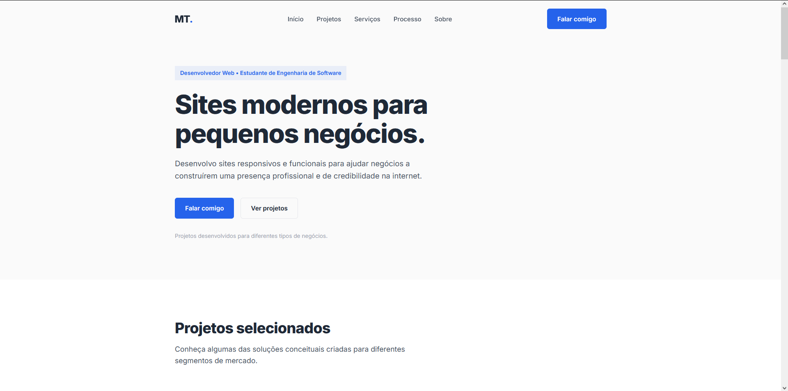
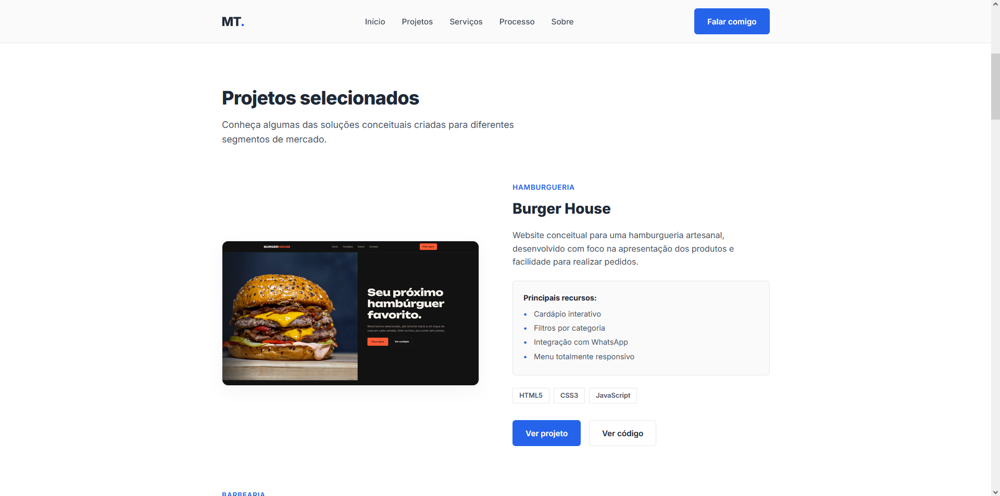
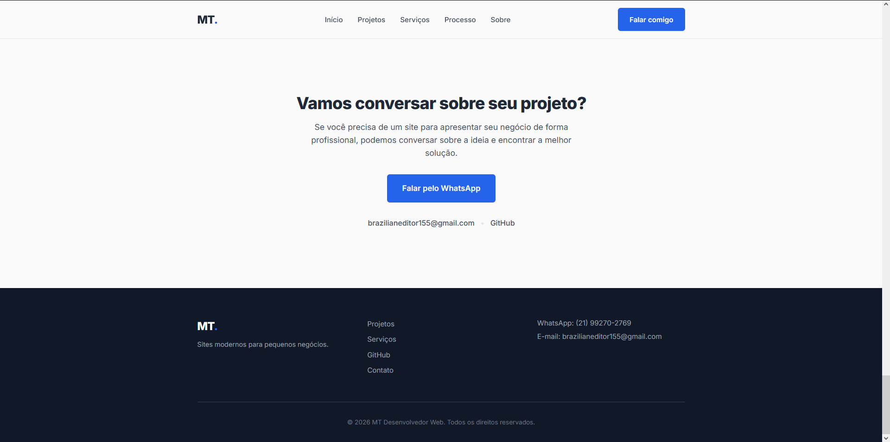

# MT Desenvolvedor Web

Website pessoal e portfólio profissional projetado especificamente para apresentar serviços de desenvolvimento web para pequenos negócios e profissionais autônomos.

## Sobre

Este projeto é um portfólio comercial focado em transmitir credibilidade, organização e competência técnica. Diferente de portfólios focados apenas em recrutadores de TI, este site foi estruturado (copywriting e design) para que um cliente final (dono de negócio local) entenda claramente o valor de se ter uma presença profissional na internet.

## Objetivo

1. Apresentar minha identidade profissional de forma limpa e transparente.
2. Demonstrar minha capacidade técnica através de projetos conceituais sólidos.
3. Converter visitantes (pequenos negócios) em contatos diretos para fechamento de projetos.

## 🖥️ Preview

### Página inicial



### Projetos



### Contato



🔗 **[Acessar o portfólio online](https://mtdesenvolvedorweb.github.io/mt-desenvolvedor-web/)**

---

## Projetos Apresentados

O portfólio destaca 4 soluções web conceituais completas:
- **Burger House:** Hamburgueria artesanal (foco em apresentação de cardápio e UI/UX).
- **Noble Cut:** Barbearia moderna (foco em serviços e agendamentos).
- **Casa Aurora:** Hospedagem/Pousada (foco em galeria e reservas).
- **Iron District:** Academia (foco em planos, interatividade e captação de leads).

## Tecnologias

Neste projeto utilizei a base fundamental e mais leve da web, sem frameworks ou bibliotecas pesadas:
- HTML5
- CSS3
- JavaScript (Vanilla)

## Funcionalidades

- **Design Responsivo Avançado:** Adaptado meticulosamente para Mobile, Tablets e Desktops sem falhas de overflow.
- **Animações de Scroll (Intersection Observer):** Entradas sutis que não prejudicam a performance.
- **Integração Centralizada:** CTA de WhatsApp com mensagem configurada nativamente via JS.
- **Performance First:** Fontes otimizadas, imagens com atributos `loading="lazy"` e ausência de bloqueadores de renderização desnecessários.

## Estrutura do projeto

```text
mt-desenvolvedor-web/
│
├── index.html
├── css/style.css
├── js/script.js
├── images/projects/
└── README.md
